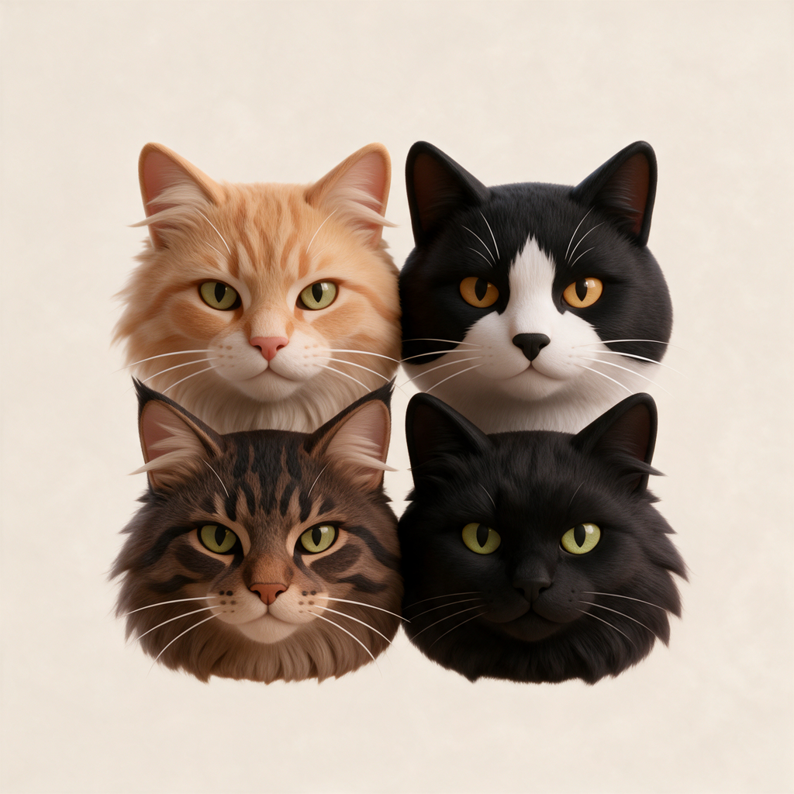
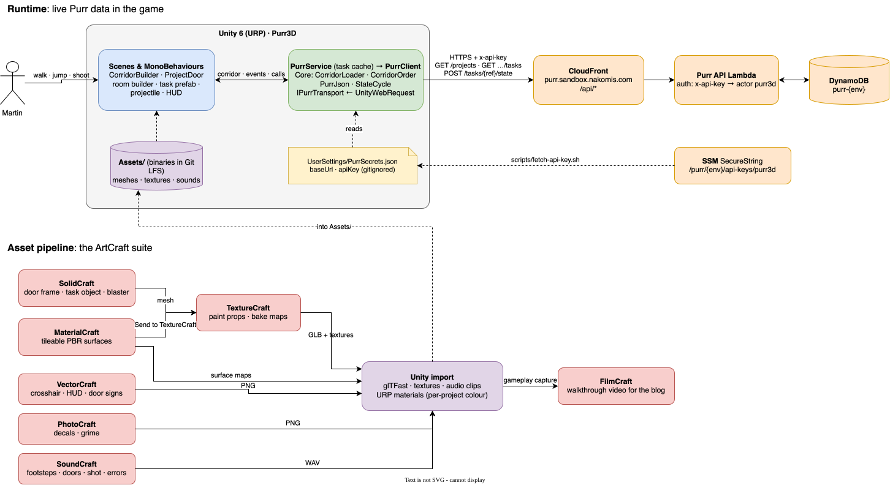

# Purr3D — A first-person Unity walk through Purr



## Support

If you find this useful, please consider buying me a coffee:

[](https://www.paypal.com/donate?hosted_button_id=Q3BESC73EWVNN&custom=purr3d)

## Table of Contents

<!-- toc -->

- [What is this?](#what-is-this)
- [Architecture Diagram](#architecture-diagram)
- [Repository Layout](#repository-layout)
- [Getting started](#getting-started)
- [ArtCraft pipeline](#artcraft-pipeline)
- [Architecture Diagrams](#architecture-diagrams)
- [Support](#support)

<!-- tocstop -->

## What is this?

[Purr](https://github.com/nakomis/purr) is a serverless task tracker: projects, tasks, cross-project epics and a priorities board. Purr3D is the same data turned into a place you can walk around:

- **The corridor**: one door per project, labelled with its live name and prefix.
- **The rooms**: each project's board laid out on the floor. There is one zone per state, and each task is a physical object sitting in its state's zone.
- **Jump on a task** to read its ref, title, state and points.
- **Shoot a task** to move it to the next state. It flies across the room to its new zone. If the Purr API refuses the change, the task snaps back.

It's a fun side project built in Unity 6, with an art pipeline based on the [ArtCraft](https://getartcraft.com) suite.

## Architecture Diagram



## Repository Layout

| Path | What lives there |
|---|---|
| `Assets/`, `Packages/`, `ProjectSettings/` | The Unity 6 project (URP) |
| `Assets/Purr3D/Core/` | Engine-free C#: Purr's types, JSON parsing, the state-cycling rule and the API client, behind an `IPurrTransport` port |
| `Assets/Purr3D/Runtime/` | The Unity side: a `UnityWebRequest` transport, settings, and the `PurrService` MonoBehaviour that scenes talk to |
| `tests/Purr3D.Core.Tests/` | NUnit tests for `Core`, run with plain `dotnet test`, so no Unity is needed (CI runs them too) |
| `ArtSource/` | Working files from the ArtCraft apps (MaterialCraft, TextureCraft, SolidCraft, VectorCraft, PhotoCraft, SoundCraft, FilmCraft), stored in Git LFS |
| `docs/guides/` | Step-by-step guides for the editor-side work |
| `docs/architecture/` | The architecture diagram |

## Getting started

1. Install Unity Hub, then the latest **Unity 6 LTS** editor.
2. Clone, then set up hooks and LFS:

   ```bash
   git clone git@github.com:nakomis/purr3d.git
   cd purr3d
   git config core.hooksPath .githooks
   git lfs pull
   ```

   `.githooks/` holds the Git LFS hooks as well as the diagram/TOC pre-commit hook. Pointing `core.hooksPath` anywhere else would quietly stop LFS files being pushed.

3. Fetch the API key (needs AWS access to the Purr account):

   ```bash
   scripts/fetch-api-key.sh          # sandbox; or: scripts/fetch-api-key.sh prod
   ```

   This writes `UserSettings/PurrSecrets.json` (per-user, gitignored), which holds the base URL and the `purr3d` actor's key.

4. Open the folder in Unity Hub (**Add → Add project from disk**).

5. Run the core tests with `dotnet test tests/Purr3D.Core.Tests`.

## ArtCraft pipeline

| App | Job |
|---|---|
| MaterialCraft | Tileable PBR surfaces for the corridor, doors and room floors. Each project gets its own colour through a Material Instance parameter. |
| SolidCraft | Door frames, the task object and the blaster |
| TextureCraft | Paints those props with MaterialCraft materials and exports GLB for Unity |
| VectorCraft | Crosshair, HUD and door-sign graphics |
| PhotoCraft | Decals and grime |
| SoundCraft | Footsteps, doors, the shot, and the sounds for a state change and a rejected change |
| FilmCraft | The walkthrough video |

## Architecture Diagrams

`docs/architecture/purr3d.drawio` is the source for the diagram above.
The SVG is auto-regenerated on commit by the pre-commit hook in `.githooks/pre-commit`.

To activate the hook after cloning:

```bash
git config core.hooksPath .githooks
```

## Support

If you find this useful, please consider buying me a coffee:

[](https://www.paypal.com/donate?hosted_button_id=Q3BESC73EWVNN&custom=purr3d)
